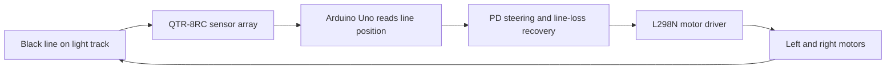

# Blixathon Line Follower

The fun part of a line follower is what happens after it stops seeing the line. This competition prototype combines an eight-sensor QTR array, centroid-based PD steering, serial tuning, and a staged coast/arc/spin recovery loop. Use it as a starting point for your own track and tune it to your wiring; PRs that make recovery smarter are welcome.

## First run

1. Review the hardware and pin map below, then open [line_follower.ino](line_follower.ino) in the Arduino IDE.
2. Install the Pololu QTRSensors library and select an Arduino Uno-compatible board.
3. Check the wiring and sensor height before powering the motors. Keep the wheels clear of the floor during the first power-on.
4. Place the array over both the line and background, upload the sketch, then test at low speed in an open area.
5. Tune gains and speed from the Serial Monitor using the controls below.

**Team:** Valley Boys Robotics
**Competition:** Coding Quest 2025
**Platform:** Arduino Uno, L298N motor driver, QTR-8RC 8-sensor array

## Control path

## Features

- QTR sensor self-calibration during startup.
- Weighted line-position estimate from all eight sensors.
- PD steering with adjustable proportional and derivative gains.
- Staged recovery when the line is lost: coast, arc in the last known direction, then spin.
- Runtime tuning through the Serial Monitor without re-uploading the sketch.
- PWM deadband compensation for the L298N and low-voltage motors.

## Hardware and pin map

| Component | Connection | Purpose |
| --- | --- | --- |
| QTR-8RC OUT1-OUT8 | D2, D3, D4, D5, D7, A2 (16), D8, A0 (14) | Reflectance sensors |
| QTR-8RC LEDON | A1 (15), optional | Emitter control |
| L298N ENA | D10 | Right motor PWM |
| L298N IN1, IN2 | D11, D12 | Right motor direction |
| L298N IN3, IN4 | D13, D9 | Left motor direction |
| L298N ENB | D6 | Left motor PWM |
| Power and ground | Shared ground | Supply and signal reference |

Set sensor clearance close to 2-3 mm and use diffuse lighting. Verify the motor driver and board power requirements for your hardware; do not assume the Arduino 5 V pin can power the motors.

## Tuning

| Setting | Starting value in sketch | Serial controls |
| --- | ---: | --- |
| `Kp` | 0.22 | `+` / `-` |
| `Kd` | 1.10 | `>` / `<` |
| `BASE_SPEED` | 90 PWM | `]` / `[` |
| `BOOST` | 20 PWM | `)` / `(` |
| Show current values | - | `S` |

`MIN_PWM` starts at 60. The sketch calibrates at startup; reset the board to repeat calibration. Tune on the actual track and chassis because motors, battery voltage, sensor height, and lighting change the response.

## Project status

This repository contains the Arduino sketch and these setup notes. It does not include a wiring-diagram image or robot demo recording, so the pin table and control flow above describe the code rather than a verified hardware build.
